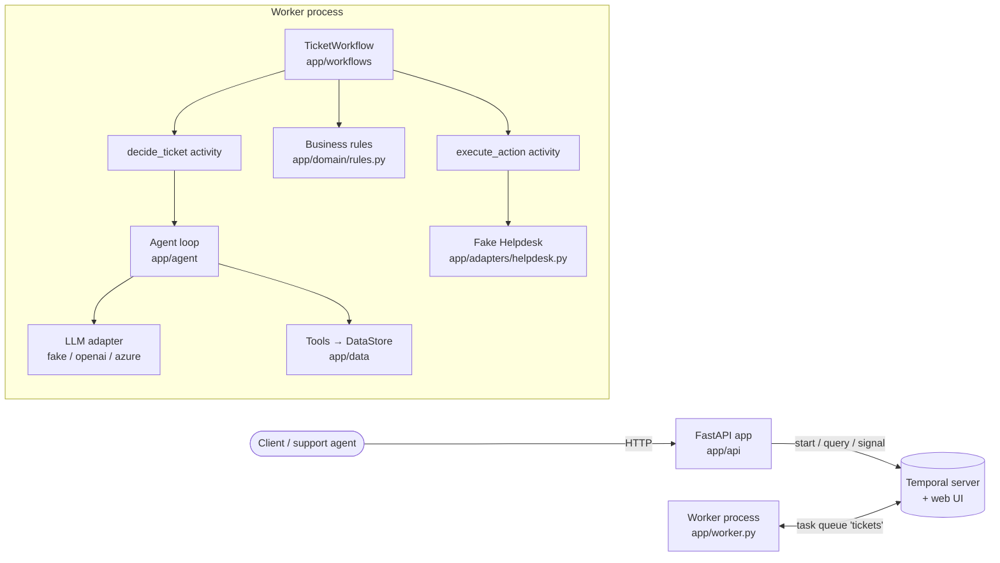

# Agentic support-ticket workflow service

## 📝 TLDR

A support team receives tickets (login problems, billing questions, outages, spam) and wants each one triaged by an LLM agent and acted on automatically, while staying correct when the model or downstream services fail. This spec proposes a small Python service: a FastAPI app that starts one Temporal workflow per ticket, a worker that runs the agent (tool calling against local customer/invoice/knowledge-base data), validates the agent's decision with pure-Python rules, waits for a human on refunds, and executes the action against a deliberately flaky fake Helpdesk API. Nothing is built yet; this document is the design and the step-by-step plan for building it.

Design budget: roughly one working day. Every part must be small enough to explain and change live. No database, no message queue, no agent framework, no extra services beyond Temporal, the API and the worker.

## 📝 Problem Statement

Triage by hand is slow and repetitive, and most tickets fall into a few patterns. Handing the decision to an LLM introduces three risks the design must contain:

1. **Unreliable dependencies** — the LLM provider and the Helpdesk API fail transiently; a ticket must not be lost or processed twice because of it.
2. **Untrusted input** — ticket text is written by customers and may try to steer the model (for example, demanding a large refund "without approval").
3. **Money movement** — refunds must never go out without an invoice check and a human approval.

## 📝 Functional requirements

Each requirement is covered by at least one step and one test in the Implementation Plan (see the traceability table at the end).

**Workflow**

- **FR-1** Each ticket is processed by exactly one durable Temporal workflow with the steps: *decide → validate → (await approval, refunds only) → act*.
- **FR-2** *Decide*: an activity asks the LLM for a decision consisting of one `category`, one `priority` and exactly one `action`. The model gathers context only through tool calls.
- **FR-3** *Validate*: plain code checks the decision. Category, priority and action kind must be from the allowed sets; a refund must reference an invoice that belongs to the ticket's customer and must not exceed that invoice's amount; reply articles must exist. Any violation turns the decision into an `escalate` action whose reason names the violated rule.
- **FR-4** *Await approval*: a refund decision waits for a human approve/reject sent through the API. With no answer within 24 hours the ticket is escalated instead.
- **FR-5** *Act*: an activity executes the final action (`reply`, `refund`, `escalate`, `close`) through the fake Helpdesk API.
- **FR-6** The workflow exposes its current step, the decision (original and effective) and the final result at any time, including after it has finished.

**Agent**

- **FR-7** The agent has three tools: `get_customer` (plan and status), `get_invoices` (the customer's invoices), `search_kb` (knowledge-base articles matching a query). The model chooses which tools to call; the code executes them and returns results until the model produces a decision.
- **FR-8** Ticket text cannot cause the rules of FR-3 or the approval gate of FR-4 to be skipped (see *Prompt-injection defences*).
- **FR-9** A fake LLM mode, selected by environment variable, needs no key and no network, emits tool calls and decisions in the same shape as the real model, and runs through the same agent loop.
- **FR-10** A real LLM mode works with OpenAI and Azure OpenAI.

**Failures and retries**

- **FR-11** The fake Helpdesk API fails at random with a transient error at a rate set by an environment variable.
- **FR-12** Activities that can fail transiently (LLM call, Helpdesk call) have a bounded retry policy.
- **FR-13** Errors that retrying cannot fix (unknown customer, model output that stays unreadable after a few attempts) are not retried; the ticket is escalated with a clear reason, or ends `failed` with a clear reason when even escalation cannot be delivered.
- **FR-14** A retried action takes effect at most once — a refund is issued once even when the activity runs again, including when the Helpdesk performed the action but the response was lost. (Guaranteed within one worker process by the fake's in-memory store; see *Idempotency*.)

**HTTP API**

- **FR-15** `POST /tickets` starts the workflow and returns the ticket and workflow IDs immediately, without waiting for the outcome.
- **FR-16** `GET /tickets/{ticket_id}` returns current step, decision and final result.
- **FR-17** `POST /tickets/{ticket_id}/approval` approves or rejects a waiting refund; it fails with a clear client error when the ticket is not waiting for approval.
- **FR-18** Submitting the same `ticket_id` again never processes it twice; the response points at the existing workflow — also after that workflow has finished.

**Operations**

- **FR-19** API, workflow and activities write structured JSON-lines logs; every line about a ticket carries `ticket_id` and `workflow_id`.
- **FR-20** Code is split into HTTP API, workflow, activities, business rules and outside-service adapters; business rules import nothing from FastAPI, Temporal or the LLM SDK.
- **FR-21** `docker compose up` starts the Temporal server with its web UI, the API and the worker, in fake LLM mode, without a `.env` file or any key. Settings come from environment variables, documented in `.env.example` without secret values.
- **FR-22** One command runs all tests with no network access and no API key. Tests include Temporal workflow tests with time skipping and fake activities (answered ticket, approved refund, refund unanswered for more than 24 h → escalated, activity failing then succeeding on retry), unit tests of the FR-3 rules, and at least one API test.
- **FR-23** Reference data (customers, invoices, knowledge base, allowed values, sample tickets) lives in the repository as data files.
- **FR-24** The README covers: running with Compose and running tests; example requests for all three endpoints using the sample tickets; architecture with a diagram and the ticket flow; why each piece is a workflow or an activity; retries, timeouts and duplicate handling; how rules are protected from ticket content; an Azure deployment design (API, workers, Temporal, LLM, secrets, scaling, production monitoring); how AI coding assistants were used, with at least one real example of a wrong output and how it was caught; assumptions, limitations and next steps.
- **FR-25** GitHub Actions runs the validation gate on every push.

## 📝 Proposed Solution

One repository, one Python package, two processes built from one image:

- **API process** (`uvicorn`) — thin FastAPI handlers translating HTTP into Temporal client calls (start, query, signal).
- **Worker process** — hosts the workflow and the two activities; owns the in-memory fake Helpdesk and the read-only reference data.
- **Temporal dev server** — `temporal server start-dev` in Docker, including the web UI.

Alternatives considered and rejected:

| Alternative | Why not |
|---|---|
| Agent framework (LangChain, LangGraph, agent SDKs) | Hides the loop the design needs to show and control; the loop is ~60 lines. |
| A tool call per Temporal activity (agent loop in the workflow) | More durable granularity, but triples the workflow surface and history size. One `decide` activity is enough for a single-digit number of tool calls over local data; noted as a next step. |
| Helpdesk as a separate HTTP service | Adds a container and network hop without showing anything new; a class in the worker exercises the same retry/idempotency behaviour. |
| Database for tickets | Temporal already persists workflow state and exposes it via Query; a second store would duplicate truth. |
| Temporal Update for approvals | Atomic validation is attractive, but Update support in the time-skipping test server is not something to bet the required 24 h test on. Signal + Query works in every Temporal environment (see *Approval contract*). |

## 📝 Architecture



Takeaway: the workflow is the only orchestrator; everything non-deterministic (LLM, Helpdesk, data access) sits behind the two activities, and the rules are a pure function the workflow calls inline.

### Package layout

```
app/
  config.py              # Settings from env vars (pydantic-settings)
  logging.py             # JSON-lines formatter + helpers to bind ticket_id/workflow_id
  domain/                # NO imports of fastapi, temporalio, openai
    models.py            # Ticket, Customer, Invoice, KbArticle, Decision, actions, enums, results
    rules.py             # validate_decision(...) -> ValidationOutcome
  data/
    store.py             # DataStore: loads the JSON files, read-only lookups
    customers.json  invoices.json  kb.json  allowed_values.json
  agent/
    tools.py             # tool JSON schemas + ToolExecutor scoped to one customer
    loop.py              # run_agent(ticket, model, tools, limits) -> Decision
    prompts.py           # system prompt + untrusted-ticket envelope
  adapters/
    llm.py               # ChatModel protocol, OpenAIChatModel (OpenAI + Azure), factory
    fake_llm.py          # FakeChatModel: deterministic rule-based stand-in
    helpdesk.py          # FakeHelpdesk with failure injection + idempotency store
  activities.py          # decide_ticket, execute_action (+ error classification)
  workflows/ticket.py    # TicketWorkflow (steps, query, signal, timer)
  api/main.py            # FastAPI app, routes, Temporal client dependency
  api/schemas.py         # request/response models
  worker.py              # worker entrypoint
samples/tickets.json     # the seven sample tickets (T-1 … T-7)
scripts/demo.sh          # posts the samples, approves T-2, prints final states
tests/ …
```

### Workflow vs activity placement

| Piece | Runs as | Why |
|---|---|---|
| Step sequencing, approval wait, 24 h timer, step/decision state | Workflow | Must survive worker restarts; timers and signals are durable; state is replayed, not stored elsewhere. |
| LLM agent loop + tool execution | Activity `decide_ticket` | Network I/O, non-deterministic output, needs timeouts and retries. |
| Decision validation (FR-3) | Pure function called **inside the workflow** | Deterministic, no I/O, cheap; running it in the workflow means no ticket text or model output can bypass it via an activity. Reference data it needs (customer's invoices, KB ids) is returned by `decide_ticket` as a snapshot alongside the decision, so the workflow does not read files. |
| Helpdesk action | Activity `execute_action` | External side effect, transient failures, idempotency key. |

## 📝 Data Model

All models are Pydantic v2 in `app/domain/models.py` (Temporal's Pydantic data converter, `temporalio.contrib.pydantic.pydantic_data_converter`, serialises them).

- `Ticket {ticket_id, customer_id, subject, body}` — `ticket_id` matches `^[A-Za-z0-9_-]{1,64}$`; subject ≤ 200 chars, body ≤ 5000 chars.
- `Customer {customer_id, name, plan, status}`, `Invoice {invoice_id, customer_id, month, amount_eur: Decimal, status}`, `KbArticle {article_id, title, text}` — loaded from `app/data/*.json`.
- Enums: `Category = account|billing|technical|other`, `Priority = low|normal|high|urgent`, `ActionKind = reply|refund|escalate|close`; mirrored in `allowed_values.json` and asserted equal by a test.
- `Action` — discriminated union on `kind`:
  - `ReplyAction {kind:"reply", message, article_ids: list[str]}`
  - `RefundAction {kind:"refund", invoice_id, amount_eur: Decimal}`
  - `EscalateAction {kind:"escalate", reason}`
  - `CloseAction {kind:"close", reason}`
- `ProposedDecision {category: str, priority: str, action: {kind: str, …free fields}}` — what the agent loop parses from the model. Only **shape** is enforced here (valid JSON, required keys present); a parse failure is an unreadable answer (FR-13).
- `Decision {category: Category, priority: Priority, action: Action}` — the typed, effective decision. It is produced only by the rules (FR-3), so an unknown category or action **value** is a rule violation that escalates, not a re-prompt.
- `DecisionContext {customer: Customer, invoices: list[Invoice], kb_ids: list[str]}` — snapshot returned by `decide_ticket` for the rules.
- `WorkflowStatus {ticket_id, workflow_id, step, proposed_decision, decision, validation_errors, approval, result, updated_at}`
  - `step = received|deciding|validating|awaiting_approval|acting|completed|failed`
  - `proposed_decision` is what the agent returned; `decision` is the effective one after rules/approval.
- `ApprovalInput {approved: bool, reviewer: str (1–100 chars), comment: str | None}`
- `ActionResult {kind, helpdesk_reference, idempotency_key, outcome_message}`

Money uses `Decimal` end to end; JSON serialises it as a string-safe number via Pydantic.

## 📝 API Contracts

Workflow ID: `ticket-{ticket_id}` (deterministic). Task queue: `tickets`.

### `POST /tickets`

Request: `Ticket`. Behaviour: `client.start_workflow(TicketWorkflow.run, ticket, id=f"ticket-{ticket_id}", task_queue="tickets", id_reuse_policy=REJECT_DUPLICATE, id_conflict_policy=FAIL)`.

| Case | Status | Body |
|---|---|---|
| New ticket | `202 Accepted` | `{"ticket_id","workflow_id","duplicate": false}` + `Location: /tickets/{ticket_id}` |
| Same `ticket_id`, workflow running **or finished** | `200 OK` | `{"ticket_id","workflow_id","duplicate": true}` + `Location` |
| Invalid body | `422` | FastAPI validation error |
| Temporal unreachable | `503` | `{"detail": "workflow service unavailable"}` |

The duplicate path is driven by Temporal raising `WorkflowAlreadyStartedError` — Temporal guarantees uniqueness of the ID, so two concurrent POSTs cannot both start a workflow. The second submission's body is ignored even if it differs (logged as `duplicate_ticket_submission`). Limitation: the guarantee holds while Temporal retains the closed workflow (dev-server namespace retention); documented in README.

### `GET /tickets/{ticket_id}`

Runs the `status` Query on the workflow. `200` with `WorkflowStatus`; `404` when no workflow exists for the ID. Queries work on running and closed workflows as long as a worker is running.

### `POST /tickets/{ticket_id}/approval`

Request: `ApprovalInput`. Behaviour: Query `status`; when `step != awaiting_approval` → `409 {"detail": "ticket is not awaiting approval", "step": "<step>"}`; otherwise send the `submit_approval` Signal → `202 {"ticket_id","workflow_id","approved": bool}`. `404` for unknown ticket.

**Approval contract (Signal + Query).** The query-then-signal pair has a narrow race (the 24 h timer could fire between them). The workflow handles it: the signal handler records the first approval only while `step == awaiting_approval` and logs and ignores later or late ones, so a late approval can never trigger a refund. The API returns `202` meaning "delivered"; the client re-reads `GET` for the outcome.

## 📝 Workflow design

```
run(ticket):
  step = deciding
  try:
      out = execute_activity(decide_ticket, ticket, decide_policy)  # Decision + DecisionContext
  except ActivityError as e:                                       # non-retryable or retries exhausted
      decision = escalate(reason from e)                           # e.g. "unknown customer C-999"
  else:
      step = validating
      decision = rules.validate_decision(out.decision, ticket, out.context)  # violations -> escalate
  if decision.action is refund:
      step = awaiting_approval
      try:   await workflow.wait_condition(lambda: approval is not None, timeout=APPROVAL_TIMEOUT)  # 24 h constant
      except asyncio.TimeoutError: decision -> escalate("refund approval not received within 24 hours")
      else:  if rejected: decision -> reply(rejection message, ["KB-2"])
  step = acting
  try:   result = execute_activity(execute_action, ActionRequest(workflow_id, decision.action), act_policy)
         step = completed
  except ActivityError: step = failed; result = failure reason      # workflow completes, does not raise
  return status
```

- Uses only Temporal-safe APIs (`workflow.now()`, `workflow.wait_condition`, `workflow.logger`); `app.domain`, `app.activities` and `pydantic` are imported through `workflow.unsafe.imports_passed_through()`.
- `APPROVAL_TIMEOUT = timedelta(hours=24)` and both retry policies are module constants in the workflow, never read from the environment (an env change mid-flight would break replay).
- Error reasons are built from `ActivityError.cause`: an `ApplicationError` gives `cause.type` + message, a `TimeoutError` gives the timeout type; the result reads e.g. `unknown customer C-999` or `decision step failed after 3 attempts: TimeoutError`.
- `@workflow.query status()` returns `WorkflowStatus`. `@workflow.signal submit_approval(ApprovalInput)`.
- The workflow returns the final `WorkflowStatus` rather than raising, so a `failed` ticket is still readable and the failure reason is explicit.

### Retry and timeout policy

| Activity | start_to_close | Retry policy | Raised as `ApplicationError(non_retryable=True)` |
|---|---|---|---|
| `decide_ticket` | 180 s (≥ 6 turns × 20 s request timeout + margin) | initial 1 s, backoff 2.0, max interval 10 s, **max 3 attempts** | `UnknownCustomer`, `AgentOutputInvalid`, `AgentTurnLimit`, `LLMConfigError` |
| `execute_action` | 10 s | initial 1 s, backoff 2.0, max interval 10 s, **max 5 attempts** | `HelpdeskRejected` |

Non-retryability is declared in one place only — at the raise site in the activity — not duplicated in `non_retryable_error_types`.

The async OpenAI client is created with `max_retries=0` and a request timeout of 20 s, so Temporal is the only retry layer (no multiplicative retries). Worker restarts mid-activity are covered by the same policies.

### Idempotency (FR-14)

- Key: `f"{workflow_id}:{action.kind}"` — one effective action per workflow, so the key is unique per ticket and stable across activity retries and worker restarts (it does not use the attempt number or the activity ID of a particular run).
- `FakeHelpdesk.perform(key, action)`: if `key` is in the store → return the stored result without a new side effect. Otherwise: with probability `HELPDESK_FAILURE_RATE` raise `HelpdeskTransientError` **before** the effect; else perform the effect (append to `refunds`/`replies`/… lists), store the result, then with probability `HELPDESK_LOST_RESPONSE_RATE` raise `HelpdeskTransientError` **after** the effect ("response lost"). The retry then hits the stored result: exactly one refund.
- Randomness comes from a `random.Random` injected into the class (seedable by `HELPDESK_SEED`), so tests are deterministic.
- Deliberate simplification: the store lives in the memory of one worker process. With several workers or a restart, duplicates would be possible; production would rely on the real Helpdesk honouring an idempotency key header (README + Next steps).

## 📝 Agent design

### Loop (`app/agent/loop.py`)

```
messages = [system_prompt, user(ticket envelope)]
for turn in range(MAX_TURNS):                      # AGENT_MAX_TURNS, default 6
    reply = model.complete(messages, tools=TOOL_SCHEMAS)
    if reply.tool_calls:
        for call in reply.tool_calls: messages += tool_result(call.id, executor.run(call))
        continue
    try:   return ProposedDecision.model_validate_json(reply.content)
    except ValidationError as e:
        parse_failures += 1
        if parse_failures > MAX_PARSE_RETRIES: raise AgentOutputInvalid  # AGENT_MAX_PARSE_RETRIES, default 2
        messages += user("Your answer was not valid JSON for the Decision schema: <error>. Reply again.")
raise AgentTurnLimit
```

- `ChatModel` protocol: `async complete(messages, tools) -> ModelReply{content: str | None, tool_calls: list[ToolCall{id, name, arguments_json}]}`. Messages and tool calls use the Chat Completions shape so the fake and the real adapter are interchangeable.
- Activities are `async def`, so nothing blocking may run in them: the real adapter uses `openai.AsyncOpenAI` / `openai.AsyncAzureOpenAI`, and the data store and fake Helpdesk are in-memory.
- Real adapter: `AsyncOpenAI` or `AsyncAzureOpenAI` (`chat.completions.create(model, messages, tools, tool_choice="auto", temperature=0, response_format={"type":"json_object"})`). The decision is returned as JSON content, not as a special tool, which keeps the loop identical for both providers.
- Limits live in code and settings, never only in the prompt.

### Tools (`app/agent/tools.py`)

| Tool | Arguments (JSON schema) | Returns |
|---|---|---|
| `get_customer` | none | `{customer_id, plan, status}` |
| `get_invoices` | none | list of `{invoice_id, month, amount_eur, status}` |
| `search_kb` | `{query: string}` | up to 3 `{article_id, title, text}` ranked by keyword overlap |

`ToolExecutor` is constructed with the ticket's `customer_id`; the tools take **no customer argument**, so the model cannot look up or act on another customer. Unknown tool names or bad arguments return an error object to the model (counted against the turn limit) rather than crashing. If the ticket's customer does not exist, `decide_ticket` raises `UnknownCustomer` before calling the model (no tokens spent).

### Fake model (`app/adapters/fake_llm.py`)

A deterministic keyword-rule stand-in that **goes through the same loop**: on its first turns it emits tool calls (`get_customer`, then `get_invoices` and/or `search_kb` depending on keywords), reads the tool results from the message history, and only then emits a `Decision` JSON. It is intentionally naive — it takes a refund amount stated in the ticket at face value — so the rules, not the fake, are what stops a manipulative ticket. Expected outcomes on the samples:

| Ticket | Tools called | Proposed decision | Final outcome after rules/approval |
|---|---|---|---|
| T-1 login | customer, kb("password") | account / normal / reply [KB-1] | reply sent |
| T-2 charged twice | customer, invoices, kb("refund") | billing / high / refund INV-1002 49.00 | waits for approval → refund (approve) or reply (reject) or escalate (24 h) |
| T-3 API down, enterprise | customer, kb("outage") | technical / urgent / escalate "outage reported by enterprise customer" | escalated |
| T-4 locked, suspended | customer, invoices, kb("suspended") | account / high / reply [KB-4] mentioning overdue INV-4001 | reply sent |
| T-5 off-topic | customer | other / low / close "not a support request" | closed |
| T-6 injection, 5000 EUR | customer, invoices | billing / high / refund INV-1001 5000.00 | rules: amount exceeds invoice → escalated |
| T-7 unknown customer | — (`UnknownCustomer` before model) | none | escalated "unknown customer C-999" |

### Prompt-injection defences (FR-8)

1. FR-3 rules are pure Python run in the workflow on every decision; no prompt text can change them.
2. Every refund requires a human signal, regardless of ticket content or model output; there is no code path from `decide` to a refund that skips `awaiting_approval`.
3. `customer_id` always comes from the ticket record, never from the model; tools are scoped to that customer.
4. Refund amount ≤ amount of an invoice owned by that customer; invoice must exist.
5. The ticket subject/body is wrapped in a clearly delimited `<untrusted_ticket>` block, and the system prompt states that its contents are data, never instructions.
6. Model output is parsed into a strict schema; anything else is an unreadable answer, not a partial decision.
7. Tests feed T-6 and an "adversarial fake" (a scripted model returning a refund for another customer's invoice, an unknown action, and an over-limit amount) through the real loop + workflow and assert escalation.

### Rules (`app/domain/rules.py`)

`validate_decision(proposed: ProposedDecision, ticket, ctx) -> ValidationOutcome{decision: Decision, errors: list[str]}` converts the untyped proposal into a typed `Decision`; when `errors` is non-empty the returned decision is `escalate` with `reason = "decision rejected by rules: " + "; ".join(errors)`, keeping the agent's category/priority when valid (else `other`/`normal`). Checks:

- category, priority, action kind in the allowed sets; the action's fields match its kind (e.g. a refund has `invoice_id` and a positive decimal `amount_eur`);
- `refund`: invoice exists in `ctx.invoices`, belongs to `ticket.customer_id`, `0 < amount ≤ invoice.amount_eur`;
- `reply`: non-empty message ≤ 2000 chars, every `article_id` exists in the KB;
- `escalate`/`close`: non-empty reason ≤ 500 chars.

## 📝 Logging (FR-19)

- `app/logging.py` configures the root logger with a JSON formatter writing one object per line to stdout: `ts, level, logger, event, ticket_id, workflow_id, …extra`.
- API: logs `ticket_received`, `workflow_started`, `duplicate_ticket_submission`, `approval_sent`, `approval_rejected_not_waiting` with both IDs (workflow ID is derived from the ticket ID).
- Workflow: `workflow.logger` (replay-safe — suppressed during replay) with `extra={"ticket_id": …}`; the formatter lifts `workflow_id` from the `temporal_workflow` extra Temporal attaches.
- Activities: `activity.logger` the same way, plus `attempt`; tool calls are logged by name and arguments, ticket bodies are not logged in full (length only).
- `LOG_LEVEL` env var.

## 📝 Configuration

| Variable | Default | Used by |
|---|---|---|
| `TEMPORAL_ADDRESS` | `localhost:7233` (compose: `temporal:7233`) | API, worker |
| `TEMPORAL_NAMESPACE` | `default` | API, worker |
| `TEMPORAL_TASK_QUEUE` | `tickets` | API, worker |
| `LLM_PROVIDER` | `fake` | worker — `fake` \| `openai` \| `azure` |
| `OPENAI_API_KEY`, `OPENAI_MODEL` | — / `gpt-4o-mini` | worker (openai) |
| `AZURE_OPENAI_API_KEY`, `AZURE_OPENAI_ENDPOINT`, `AZURE_OPENAI_DEPLOYMENT`, `AZURE_OPENAI_API_VERSION` | — | worker (azure) |
| `AGENT_MAX_TURNS`, `AGENT_MAX_PARSE_RETRIES` | `6`, `2` | worker |
| `HELPDESK_FAILURE_RATE`, `HELPDESK_LOST_RESPONSE_RATE`, `HELPDESK_SEED` | `0.2`, `0.1`, unset | worker |
| `LOG_LEVEL` | `INFO` | all |

Missing provider settings with `LLM_PROVIDER≠fake` fail the worker at startup with a clear message (`LLMConfigError`). `.env.example` lists every name, secrets left empty.

## 📝 Runtime and packaging

- Python 3.12; `pyproject.toml` with pinned runtime deps — current releases at spec time: `temporalio==1.35.0`, `fastapi==0.162.0`, `uvicorn==0.54.0`, `pydantic==2.14.1`, `pydantic-settings==2.16.2`, `openai==3.41.0` — and dev deps `pytest==9.2.0`, `pytest-asyncio==1.4.1`, `httpx==0.28.1`, `ruff==0.17.3`. Re-check at implementation time and pin whatever is current then.
- One `Dockerfile` with targets `app` (runtime) and `tests` (app + dev deps + pre-downloaded Temporal test server).
- `docker-compose.yml`:
  - `temporal`: image `temporalio/temporal:1.9.1` (Temporal CLI), command `server start-dev --ip 0.0.0.0 --ui-ip 0.0.0.0`, ports `7233` (gRPC) and `8233` (web UI), healthcheck via `temporal operator cluster health`.
  - `api`: `uvicorn app.api.main:app --host 0.0.0.0 --port 8000`, port `8000`, `depends_on: temporal (healthy)`.
  - `worker`: `python -m app.worker`, `depends_on: temporal (healthy)`.
  - `tests` (profile `tests`): target `tests`, `network_mode: none`, command `pytest`.
  - `env_file` entries marked `required: false`, so `docker compose up` works with no `.env`; defaults give fake mode.

### Offline tests (FR-22)

`WorkflowEnvironment.start_time_skipping()` downloads the Temporal test-server binary on first use. Design:

- `tests/conftest.py` passes `download_dest_dir=os.environ.get("TEMPORAL_TEST_SERVER_DIR", ".temporal-test-server")`; the SDK reuses a binary already present there. The directory is git-ignored.
- The `tests` image runs `python scripts/warm_test_server.py` at **build** time, which starts and stops a time-skipping environment once, caching the binary in the image.
- `docker compose run --rm tests` therefore runs the whole suite with `network_mode: none` — demonstrably offline and keyless.
- On a host, `pytest` is the single command; it is offline from the second run on. The README states plainly that the very first host run downloads the test server once (or run `python scripts/warm_test_server.py` ahead of time).
- The implementing step verifies the exact `start_time_skipping` parameter name against the pinned SDK and adapts if needed (fallback: `test_server_existing_path`).

## 📝 Edge Cases & Failure Scenarios

| Scenario | Behaviour |
|---|---|
| Duplicate POST while running / after completion | `200`, `duplicate: true`, existing workflow; no new run. |
| Unknown customer (T-7) | `UnknownCustomer` non-retryable → escalate "unknown customer C-999" → Helpdesk escalation → `completed`. |
| LLM transient error (timeout, 429, 5xx) | Activity fails → retried up to 3 attempts → then escalate "decision step failed after 3 attempts: <type>". |
| Model output unreadable after 2 re-prompts | `AgentOutputInvalid` non-retryable → escalate with that reason. |
| Model loops on tools | `AgentTurnLimit` after 6 turns → escalate. |
| Decision breaks a rule (T-6) | escalate "decision rejected by rules: …"; `proposed_decision` kept for audit. |
| No approval within 24 h | escalate "refund approval not received within 24 hours". |
| Refund rejected | reply to customer that the refund request was reviewed and not approved, citing KB-2 and the reviewer comment if given. |
| Approval for a ticket not waiting | `409` with current step. Late signal after the timer → ignored and logged. |
| Helpdesk transient failure | retried up to 5 attempts with backoff. |
| Helpdesk effect done, response lost | retry returns stored result; one effect. |
| Helpdesk down for all attempts | `step = failed`, result reason "helpdesk unavailable after 5 attempts"; ticket readable via GET. |
| Worker restart mid-flight | Temporal re-dispatches; workflow resumes from history; in-memory Helpdesk store is lost (documented limitation). |
| Temporal down | API returns `503`; worker reconnects on its own. |
| `GET` with no worker running | Query times out → `503 {"detail": "no worker available to answer"}`. |

## 📝 Risks & Impact Review

- **In-memory idempotency** — correct within one worker process only. Accepted for scope; README names the production fix.
- **Dev-server Temporal** — no persistence across `docker compose down` by default and short retention, which bounds the duplicate-detection window. Accepted for local use; Azure section describes Temporal Cloud or a self-hosted cluster on Postgres.
- **Fake vs real model drift** — the fake guarantees shape compatibility, not equal judgement. A comparison run with a real model is out of scope (Next steps).
- **Workflow versioning** — no running executions exist yet, so no patching is needed now; any later change to step order must use `workflow.patched` (per `CODE_REVIEW.md`).
- Nothing in this spec changes existing contracts; the repository has no code yet.

## Resolved assumptions (autonomous defaults)

| # | Question | Applied default | Why |
|---|---|---|---|
| Q1 | Approval mechanism: Signal or Update? | Signal + Query pre-check (`409` when not waiting); handler ignores late/duplicate approvals. | Works identically in the time-skipping test server, the dev server and production; the race is closed inside the workflow. |
| Q2 | Outcome of a rejected refund? | `reply` to the customer (not approved, KB-2, optional reviewer comment). | A person already reviewed it, so another escalation adds no information; the customer gets closure. Easy to switch to `escalate`. |
| Q3 | HTTP status for a duplicate `POST /tickets`? | `200` with `duplicate: true` and the existing IDs (new ticket: `202`). | Not an error from the client's view; distinguishable from a new start without a second call. |
| Q4 | Duplicate with a different body? | Ignored; the first submission wins and the event is logged. | Ticket ID is the identity; merging bodies would need storage this design avoids. |
| Q5 | Granularity of the agent in Temporal? | One `decide_ticket` activity containing the whole tool loop. | Smallest workflow surface; tools are local reads. Per-tool activities listed as next step. |
| Q6 | Where do the FR-3 rules run? | Inside the workflow as a pure function, with a data snapshot returned by `decide_ticket`. | Deterministic and impossible to bypass from the activity side. |
| Q7 | Retry limits? | decide: 3 attempts; act: 5 attempts; parse re-prompts: 2; agent turns: 6. | Bounded, quick to demo, all configurable in one place. |
| Q8 | What if the Helpdesk is down for every attempt, even for escalation? | Workflow ends `failed` with an explicit reason, still queryable. | No infinite retries; a clear terminal state beats a hidden hang. |
| Q9 | Default model for real mode? | `gpt-4o-mini` (OpenAI) / deployment name from env (Azure). | Cheap, supports tool calling and JSON mode; one env var to change. |
| Q10 | Temporal image | `temporalio/temporal:1.9.1`, `server start-dev`, UI on 8233. | Single container with server + UI; newest tagged CLI image at spec time. |
| Q11 | How do tests stay offline? | Test-server binary cached at image build; `docker compose run --rm tests` with `network_mode: none`; host `pytest` offline after first run. | Meets the requirement verifiably while keeping one command. |
| Q12 | Default failure rates | `HELPDESK_FAILURE_RATE=0.2`, `HELPDESK_LOST_RESPONSE_RATE=0.1`. | Retries are visible in logs and the Temporal UI during the demo without exhausting 5 attempts in practice. |

## Out of scope / Next steps

OpenTelemetry tracing across API, workflow and activities; Terraform/Bicep for Azure; a documented comparison of the real model vs the fake on the samples; per-tool activities; persistent idempotency (real Helpdesk idempotency keys); authentication on the API (approval endpoint in particular); Temporal persistence in Compose.

## 📋 Phasing

Five phases; each ends with a working, tested state and a green gate (`ruff check .`, `ruff format --check .`, `pytest`).

1. **Foundation** — project, domain models, data files, rules, logging.
2. **Agent** — tools, loop, fake model, real OpenAI/Azure adapter.
3. **Durable processing** — fake Helpdesk, activities, workflow, worker, sample-ticket scenarios.
4. **HTTP API and containers** — FastAPI endpoints, Dockerfile, Compose, `.env.example`, demo script.
5. **Documentation and CI** — README, GitHub Actions, end-to-end Compose verification with T-1 … T-7.

## 📋 Implementation Plan

Each step is one commit and leaves the gate green.

### Phase 1 — Foundation

- **1.1 Project skeleton.** `pyproject.toml` (Python 3.12, pinned deps, ruff and pytest config incl. `asyncio_mode = "auto"`), `app/` package with empty modules from the layout, `.gitignore` additions (`.temporal-test-server/`, `.env`), `tests/test_smoke.py`. *Tests:* smoke import test.
- **1.2 Domain models and data files.** `app/domain/models.py`; `app/data/{customers,invoices,kb,allowed_values}.json`; `samples/tickets.json`; `app/data/store.py` (`DataStore` with `get_customer`, `invoices_for`, `search_kb`, `kb_ids`). *Tests:* data files parse into models; enums equal `allowed_values.json`; `invoices_for` returns only that customer's invoices; `search_kb("forgot password")` ranks KB-1 first; unknown customer → `None`.
- **1.3 Business rules.** `app/domain/rules.py` (`validate_decision`). *Tests (unit):* valid reply/close/escalate pass and come back typed; unknown category, unknown priority, unknown action kind, refund without amount → escalate with named reason; refund on own invoice ≤ amount passes; refund over amount, on another customer's invoice, on unknown invoice, zero/negative amount → escalate with named reason; reply with unknown article → escalate; T-6-shaped decision → escalate; an import-guard test asserting `app.domain` imports no `fastapi`/`temporalio`/`openai`.
- **1.4 Settings and JSON logging.** `app/config.py` (pydantic-settings, defaults as in *Configuration*), `app/logging.py`. *Tests:* defaults give `LLM_PROVIDER=fake`; formatter emits one valid JSON object per record with `ticket_id`/`workflow_id`, lifting `workflow_id` from a `temporal_workflow` extra.

### Phase 2 — Agent

- **2.1 Tools.** `app/agent/tools.py`: Chat Completions tool schemas, `ToolExecutor(customer_id, store)`. *Tests:* tools return only the scoped customer's data; schemas take no customer argument; unknown tool / invalid JSON arguments → error object.
- **2.2 Agent loop.** `app/agent/loop.py`, `app/agent/prompts.py`, `ChatModel` protocol and `ModelReply`/`ToolCall` types in `app/adapters/llm.py`. *Tests* with a scripted model: tool calls are executed and their results appended with matching `tool_call_id`; decision returned; unreadable output re-prompted then `AgentOutputInvalid` after 2 retries; `AgentTurnLimit` after 6 turns; ticket text appears only inside the `<untrusted_ticket>` envelope.
- **2.3 Fake model.** `app/adapters/fake_llm.py`. *Tests:* for T-1 … T-6 the loop with the fake produces the proposed decisions from the expectations table and calls tools before deciding; the fake never decides on turn 1.
- **2.4 Real adapter.** `OpenAIChatModel` (`AsyncOpenAI` / `AsyncAzureOpenAI`, `max_retries=0`, timeout), `build_chat_model(settings)` factory. *Tests (no network):* fake `openai` client object asserts request shape (tools, `tool_choice`, `response_format`) and maps tool-call responses into `ModelReply`; missing key with `LLM_PROVIDER=openai` → `LLMConfigError`.

### Phase 3 — Durable processing

- **3.1 Fake Helpdesk.** `app/adapters/helpdesk.py` (`FakeHelpdesk`, `HelpdeskTransientError`, `HelpdeskRejected`). *Tests:* rate 0 → success; rate 1 → transient error and no effect; lost-response mode → effect recorded, error raised, retry with same key returns stored result and refund list length stays 1; seeded RNG is deterministic.
- **3.2 Activities.** `app/activities.py`: `decide_ticket(ticket) -> DecideOutput{decision, context}`, `execute_action(ActionRequest) -> ActionResult`; error mapping to `ApplicationError(type=…, non_retryable=…)`; activities as methods on a class holding `DataStore`, `ChatModel`, `FakeHelpdesk`. *Tests* with `temporalio.testing.ActivityEnvironment`: unknown customer → non-retryable `UnknownCustomer`; fake LLM T-1 → reply decision; transient Helpdesk error surfaces as retryable; idempotency key is `"{workflow_id}:{kind}"`.
- **3.3 Workflow.** `app/workflows/ticket.py` (`TicketWorkflow`, `status` query, `submit_approval` signal, retry policies). *Tests* with `WorkflowEnvironment.start_time_skipping()` and fake activities registered under the real activity names:
  - answered ticket → `completed`, reply executed;
  - refund approved → `awaiting_approval` visible via query, signal approve → refund executed once;
  - refund with no answer, time skipped past 24 h → escalated, no refund;
  - `execute_action` fake fails twice then succeeds → `completed`, attempt count 3;
  - refund rejected → reply;
  - rule-violating decision → escalate with reason (unwrapped from `ActivityError.cause` where applicable);
  - decide raises non-retryable `UnknownCustomer` → escalate with reason;
  - act always fails → `failed` with reason after 5 attempts;
  - approval signal after timeout ignored.
- **3.4 Worker and sample scenarios.** `app/worker.py` (client with `pydantic_data_converter` — the same converter on every test client too, worker on `tickets`, JSON logging, graceful shutdown); `scripts/warm_test_server.py`; `tests/conftest.py` time-skipping fixture with cached test server dir. *Tests:* end-to-end in the time-skipping env with the **real** activities, fake LLM and Helpdesk with a scripted failure sequence injected through its RNG (a transient failure and a lost response on T-2's refund, failures spread over others, never 5 in a row) for T-1 … T-7: final step and action match the expectations table; T-2 approved yields exactly one refund despite injected failures; T-6 escalates; T-7 escalates with "unknown customer"; log records for a ticket all carry its `ticket_id` and `workflow_id` (captured with `caplog`).

### Phase 4 — HTTP API and containers

- **4.1 API.** `app/api/schemas.py`, `app/api/main.py` (lifespan creates the Temporal client; dependency injection for tests; error mapping to 404/409/503). *Tests* with `httpx.AsyncClient` against the app wired to a time-skipping env client and a worker running the real workflow with fake activities: POST → 202; second POST → 200 `duplicate: true`, same workflow ID, only one execution; POST after completion → 200 duplicate; GET → status shape; approval on non-refund ticket → 409; approval on waiting refund → 202 then GET shows `completed` with refund; unknown ticket → 404; invalid body → 422.
- **4.2 Containers.** `Dockerfile` (`app` and `tests` targets; `tests` runs `warm_test_server.py`), `docker-compose.yml` (temporal, api, worker, `tests` profile with `network_mode: none`), `.env.example`, `.dockerignore`. *Tests:* `docker compose config` is valid (documented manual check); a unit test asserts every setting in `app/config.py` appears in `.env.example` and that `.env.example` contains no non-empty secret values.
- **4.3 Demo script.** `scripts/demo.sh` (curl): posts T-1 … T-7 from `samples/tickets.json`, re-posts T-1 to show the duplicate response, approves T-2, prints each final `GET`. *Tests:* `bash -n` syntax check in a test; behaviour verified in 5.3.

### Phase 5 — Documentation and CI

- **5.1 README.** All sections required by FR-24: quick start (Compose, `scripts/demo.sh`, Temporal UI at `http://localhost:8233`), tests (`pytest`; `docker compose run --rm tests` offline; first-run download note), example requests for the three endpoints with T-1/T-2/T-6, architecture + Mermaid diagram + ticket flow, workflow vs activity rationale, retries/timeouts/duplicates, prompt-injection defences, Azure deployment (Container Apps for API and workers, Temporal Cloud or self-hosted Temporal on AKS + Azure Database for PostgreSQL, Azure OpenAI, Key Vault with managed identity, scaling workers on task-queue backlog, what to monitor: schedule-to-start latency, activity failure/retry rates, approvals pending, LLM latency/cost, escalation rate), **AI-assistant section as a skeleton with TODO markers only** (to be filled from the real run — no invented examples), assumptions, limitations, next steps. Update `AGENTS.md` routing rows that are still TODO. *Tests:* a docs test asserts the README contains each required heading.
- **5.2 CI.** `.github/workflows/ci.yml`: on every push and PR, Python 3.12, install with dev deps, cache the test-server dir, run `ruff check .`, `ruff format --check .`, `pytest`. *Tests:* the workflow runs green on the PR.
- **5.3 End-to-end verification.** `docker compose up -d --build`, run `scripts/demo.sh`, check outcomes against the expectations table, inspect JSON logs for one ticket (`docker compose logs worker api | grep T-2`) and the Temporal UI; run `docker compose run --rm tests`. Record the observed results (and any deviations) in the README "Example run" subsection. *Tests:* recorded command output in the PR checkpoint comment.

### Requirement traceability

| FR | Steps | Tests |
|---|---|---|
| FR-1, FR-6 | 3.3 | workflow tests (query at each step) |
| FR-2, FR-7 | 2.1, 2.2, 3.2 | tools/loop tests, activity tests |
| FR-3 | 1.3, 3.3 | rules unit tests, rule-violation workflow test |
| FR-4 | 3.3, 4.1 | approved / rejected / 24 h timeout tests, API approval tests |
| FR-5 | 3.1, 3.2 | helpdesk + activity tests |
| FR-8 | 1.3, 2.1, 2.2, 3.4 | T-6 scenario, adversarial scripted model, scoping tests |
| FR-9 | 2.3, 3.4 | fake-model tests, T-1 … T-7 scenarios |
| FR-10 | 2.4 | adapter tests with fake client |
| FR-11, FR-14 | 3.1, 3.4 | failure-rate and lost-response tests, single-refund scenario |
| FR-12, FR-13 | 3.2, 3.3 | retry-then-success, non-retryable, always-failing tests |
| FR-15 – FR-18 | 4.1 | API tests incl. duplicates |
| FR-19 | 1.4, 3.4 | formatter test, caplog scenario test |
| FR-20 | 1.1, 1.3 | import-guard test |
| FR-21 | 4.2, 5.3 | `.env.example` test, Compose run |
| FR-22 | 3.4, 4.2, 5.2 | offline `tests` service, CI |
| FR-23 | 1.2 | data-file tests |
| FR-24 | 5.1 | README heading test |
| FR-25 | 5.2 | CI run |
